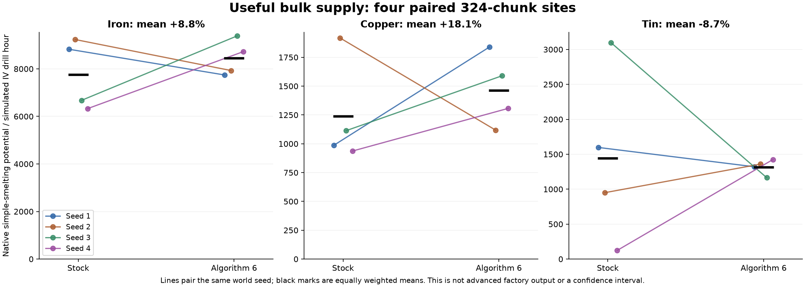

# Classic Mining for GTNH

An experimental ore-generation companion for **GT New Horizons 2.9.0-RC-2 / Minecraft 1.7.10**. Random small discoveries, related minerals, coherent lodes and rare industrial jackpots replace the regular large-vein grid. Native technology, tools, travel and automation remain the pack's responsibility.

## Before and after

Actual pre-mining server block exports from **the same seed and coordinates**, covering **18 x 18 chunks**. Left: stock GTNH. Right: the exact released Science6 generator. The overhead maps project full GT ores through **Y1-99**; the lower panels show the same fixed middle vertical slice. Colors group native smelting families; small ores are omitted. Dark space is not necessarily air. This is a data visualization of one sampled region, not a rendered screenshot or an all-seed balance guarantee. [Map method, counts and source hashes](reports/science6-map/README.md).

The isometric comparison hides host rock to reveal actual ore blocks inside one fixed central **96 x 96 x 96-block cube**. [View top-down, side-section and both isometric angles](reports/science6-map/README.md#multiple-views-of-one-fixed-ore-cube). Every angle uses the same ore volume; nearer ores can obscure those behind them.
## Download and install

**Experimental alpha, algorithm 6 / profile `bulk-20261010-v2`. Tested against GTNH 2.9.0-RC-2 and GregTech 5.09.54.205. This is an independent companion mod, not an official GTNH release.**

Download the [tested main jar from the alpha release](https://github.com/finalpantasy/classic-mining-for-gtnh/releases/tag/v0.1.0-alpha.6). Its internal mod version remains `0.1.0`; the release suffix identifies the algorithm-6 experiment.

1. Create a separate GTNH 2.9.0-RC-2 instance with no existing world.
2. Put `classic-mining-0.1.0.jar` in that instance's `.minecraft/mods` folder. Install the same main jar on a dedicated server if using one.
3. Create a **fresh world**. Defaults are `enabled=true` and `depositsPerChunk=32` in `config/classic-mining.properties`. Keep these settings fixed after world creation.

Do not install the QA mod. Do not replace a jar in an existing algorithm-3/4/5 world or another algorithm-6 profile. No migration or retrogen is provided. Keep the matching jar with the world. Back up worlds before pack/mod updates; other pack versions require retesting.

Main jar SHA256: `86e33e9080c7b4c2ca4a1b49931ba42661123a747a5395a9acf558fdd3323046`.

The release download uses the project-only `classicmining` package namespace. Its class files are identical to the originally measured binary after normalizing that namespace rename. The original measurement hashes remain in the historical reports; see [build verification](BUILD_VERIFICATION.md).

## Measured results and limits

Four paired native IV-drill sites gave mean simple-smelting potential/hour changes of **iron +8.8%, copper +18.1%, tin -8.7%** against stock. These are actual collected drops mapped through native furnace recipes, not finished-factory throughput or player hours. Individual sites differ substantially.

- 1,848 material-role fixtures cover 256 materials in 38 eligible ore-generating dimensions.
- 91,132 natural custom blocks were audited with zero material/dimension/height violations; 250 materials occurred naturally in the finite sample.
- All four custom drills completed, with zero GT ore left below their controller height.
- Eight minerals passed 24 native MV washing/thermal-centrifuging/maceration stages.
- The required-content audit found zero normalized differences across native recipes and automation tables. Output order and other auxiliary metadata are outside that claim.

**Still open:** survival enjoyment, rare planetary supply balance, generation-order integration and rendered scanner UI. VisualProspecting's cached vein labels are not verified for these irregular deposits. No unchanged two-Stargate completion-time claim is made.

Read the [scientific rationale and source references](RESEARCH_AND_LIMITS.md), [experiment and formulas](EXPERIMENT.md), [scanner limits](SCANNER_COMPATIBILITY.md), and [full aggregate evidence](reports/science6-final/results.json). Download the release's evidence ZIP and open `comparison.html` locally for the illustrated report and every paired result.

## Preliminary manual-progression estimates

The [player-policy report and per-attempt data](reports/progression-20261011/README.md) cover 1,080 fixed-policy budget attempts, 120 continuous budget campaigns and 60 exploration/inventory sensitivity campaigns across five paired seeds. The baseline matched comparisons estimated **8.4 extra mining/search hours through an LV resource budget** and **23.9 through an MV reserve budget**. A separate local-probing policy with ore-load trips estimated **8.3 and 18.0 hours**, respectively, on different matched cohorts. The MV comparisons involve only two seeds.

These are **preliminary scripted resource-budget estimates**, not measured human playthrough times or exact costs to reach a tier. Policies recover only encountered ore, not a chunk's complete contents. The report discloses partial recovery, failed/censored searches, native repair/processing measurements, assumptions and missing player strategies. It also corrects the first Ore Drilling Plant distinction: **MV operating power, EV controller components**. No full Stone-to-drill duration, unchanged progression time, or FPS/TPS claim is supported.

The [balance candidates](reports/progression-20261011/README.md#balance-assessment-and-candidates-to-test) propose further tests of early accessible discoveries while retaining bulk supply. This documentation update changes no ore generation or release binary.

## What changes

Ordinary finds coexist with seams, jackpots and industrial bodies. Mineral families use beds, stockworks, lodes, lenses, pipes, cores, crystal pockets or generic veins. Smooth regional preferences modify odds without excluding eligible background finds. This is geology-inspired game design, not an Earth-crust simulation.

Algorithm 6 corrects Overworld bulk supply using native direct-smelting identities, while preserving algorithm-5 planetary plans. Tin-bearing ordinary finds in Tin-primary layers become 6-8-block stringers; pure associated-mineral finds retain their old size. Their expected planned mass moves into rare industrial bodies. Large bodies favor iron/copper over tin using constrained, positive selection probabilities. Actual useful supply must be measured separately because caves, host rejection, depth and overlap reduce planned targets.

Read [the experiment and formulas](EXPERIMENT.md), [scanner compatibility](SCANNER_COMPATIBILITY.md), and the final evidence report. Factors and probabilities are disclosed gameplay parameters. Native eligible dimensions, materials, host rocks and height rules remain authoritative, including the End's native height exception. Scattered small ores and asteroid channels remain native.

## Progression

This mod changes physical placement only. It does not discount recipes, harvest gates, machine power/speed, travel or tool development. Void-miner tables and space-mining data are audited separately from physical ores. There is no claim of identical elapsed hours to two Stargates. Headless tests measure native harvesting, extraction and processing; supplied power, fluid, maintenance and output collection do not represent a complete factory or survival playthrough.

The provisional common-resource target is a four-site paired mean rate within 20% of stock for iron, copper and tin, measured as native simple-smelting potential from actual drill drops per simulated machine hour. Each seed and misses remain visible. Four sites do not establish all-resource or all-planet parity, and means can conceal large individual-site differences. Advanced processing fixtures demonstrate native operation; they do not automatically turn the furnace proxy into an optimized production forecast.

## Fresh worlds only

The world guard records algorithm 6 and profile `bulk-20261010-v2`. A world from another algorithm/profile must retain its matching jar. There is no migration or retrogen. Use a dedicated fresh instance and install only the custom main jar. Do not install QA jars into a player instance.

## Reproduction

The local reference uses GT5 5.09.54.205, CoreMod 2.9.84 and HorizonQA 0.15.0 with the officially obtained GTNH server. Java 25 compiles the mod to Java 8 bytecode. Build with `build.py`, `build_qa.py`, and `verify.py`. `run_qa.py` uses fresh labels, pins artifact hashes and checks completed HorizonQA results. Run one server at a time, bound to localhost; accept Minecraft's EULA yourself for your isolated server.

The workspace scripts currently resolve the shared isolated server and dependency references in the sibling `classic-mining` directory. Java paths in build/run scripts are local configuration. A public source bundle does not include third-party jars, downloaded reference source, accounts, worlds or logs. Reproduction requires configuring those dependency paths locally; it is not yet a portable one-click build.

Native drill/branch: `--native --drill-tier 4 --branch`. Coverage: `--catalog --all-planets --extra-dims`. Starter/scanner APIs: `--readiness`. Actual MV washing, thermal centrifuging and maceration: `--processing-line`. Native recipe and automation fingerprints: `--economy`. Query initialized furnace mappings for collected drill exports with `--processing-labels`. Use `--custom` to enable the generator; omit it for stock controls.

## Licensing

No open-source license has been selected. Public source availability does not designate this project as open source. See [RIGHTS.md](RIGHTS.md). Third-party dependencies are obtained separately and remain under their own licenses.

## Support

Free hobby project. If it helps you, you can [buy me a coffee on Ko-fi](https://ko-fi.com/finalpantasy). Thank you!
