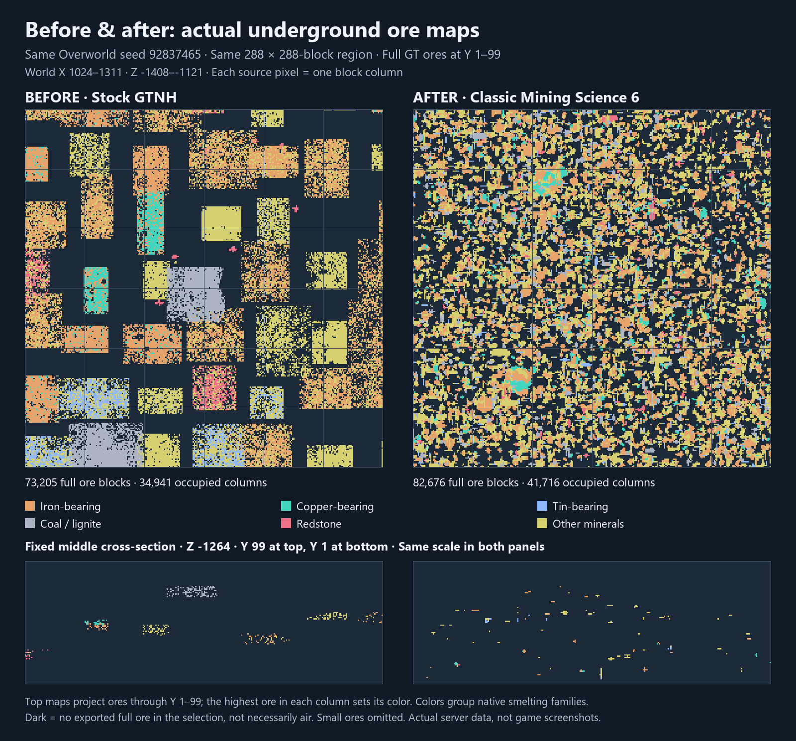
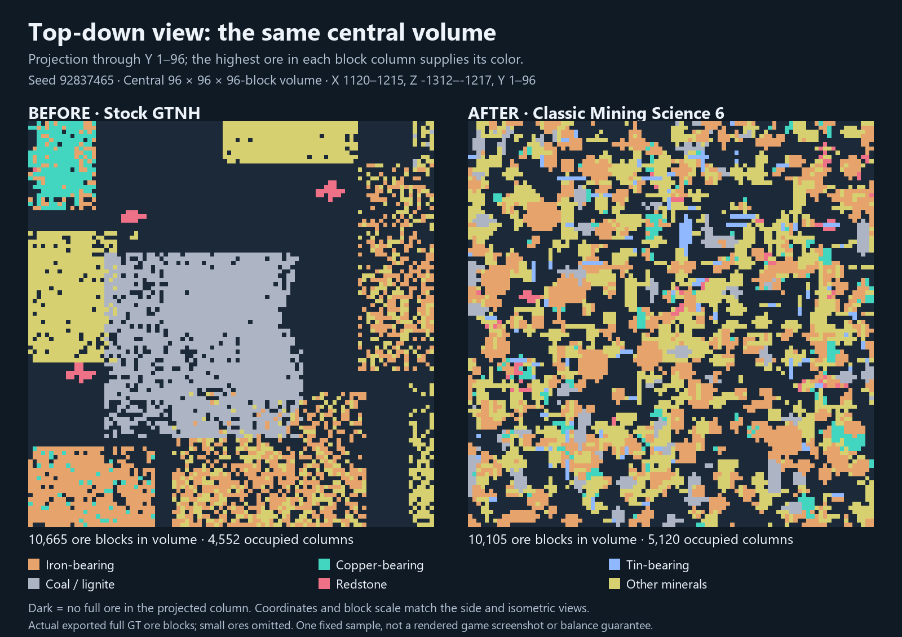
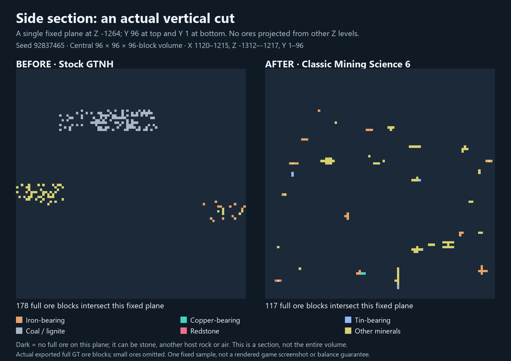
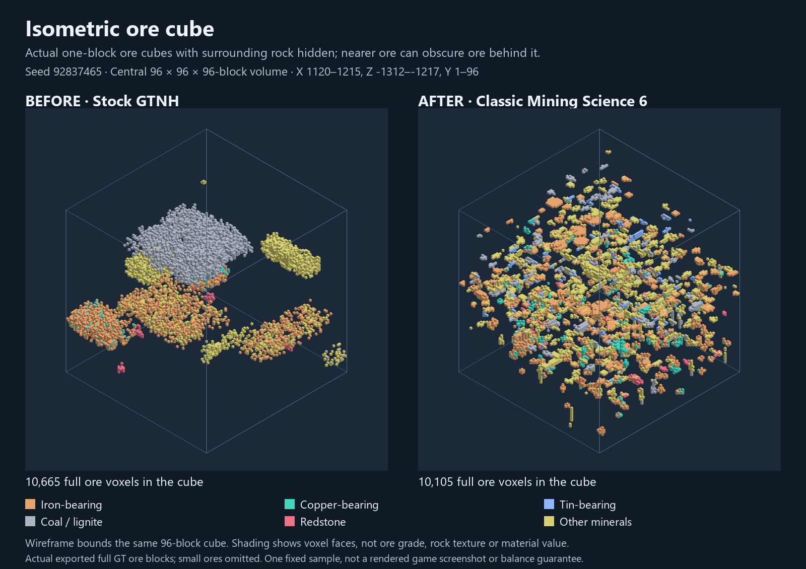
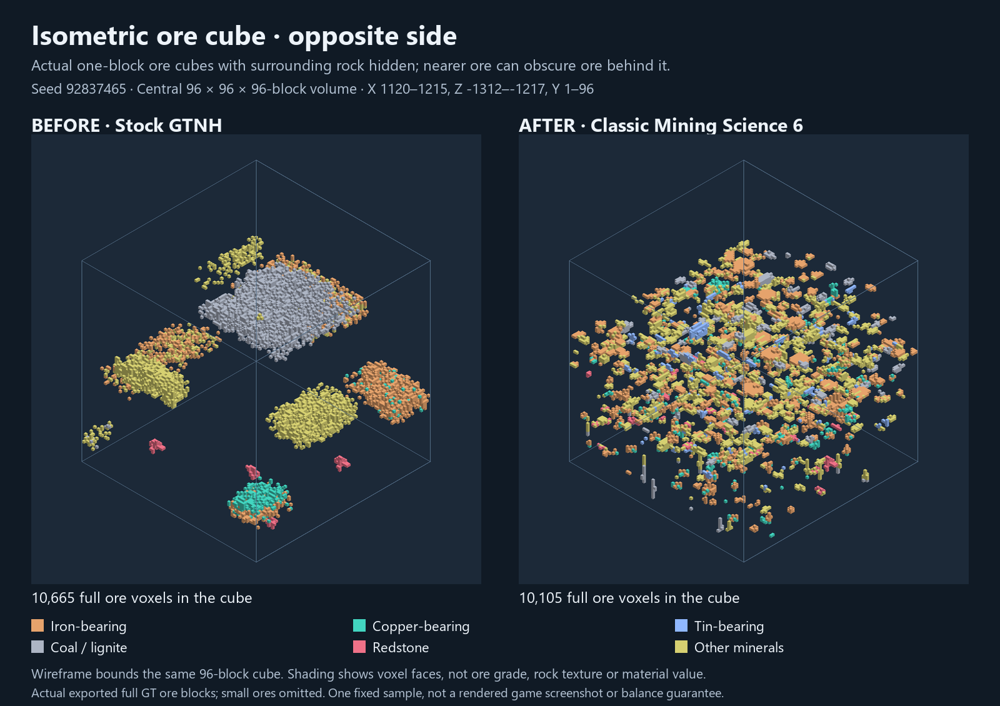

# Actual before-and-after ore maps

Seed **92837465**, Overworld, **18 × 18 chunks** at X1024–1311, Z−1408–−1121. The complete first paired drill footprint is shown **before any branch mining or drill extraction**. This is the first calibration pair, with a fixed midpoint cross-section, not a selected jackpot showcase.

Top panels project all full GT ore blocks at **Y1–99** onto X/Z columns. The highest selected ore supplies each column color; stacked ores can be hidden. Six colors group native direct-smelting iron/copper/tin identities, coal/lignite, redstone and other minerals. Small ores are omitted. Dark space means no exported full ore in the selection, not necessarily an air block. Guide lines are 48 blocks apart. Lower panels show one actual vertical slice through the region midpoint, **Z−1264**.

Before: 73,205 full ore blocks. After: 82,676 full ore blocks. Counts are blocks, not ingot yields or mining time.

The worlds share seed, coordinates and settings; native terrain and generation order can differ. This is an actual server block export visualization, not a rendered Minecraft screenshot. It illustrates distribution in one region and does not prove population-wide balance. [Metadata, counts and source hashes](map-data.json). Reproduce with `python make_ore_map.py --data-root <local-Science6-reports>`; raw exports/dependencies must be obtained separately.

## Multiple views of one fixed ore cube

All four views below use the same **central 96 x 96 x 96-block** subvolume: X1120-1215, Z-1312 to -1217, Y1-96. This is a fixed central crop for readability, not a chosen jackpot. The overhead overview above still covers the whole 288 x 288-block region. The isometric images render actual one-block ore cubes with host rock omitted. Nearby ores hide distant ones; the opposite angle helps reveal that occlusion. No ore geometry is invented.

### Top down

### Side section, Z-1264

### Isometric cube

### Opposite isometric angle

[View metadata and counts](views-data.json). Reproduce with `python make_ore_views.py --data-root <local-Science6-reports>` after making the overview.
